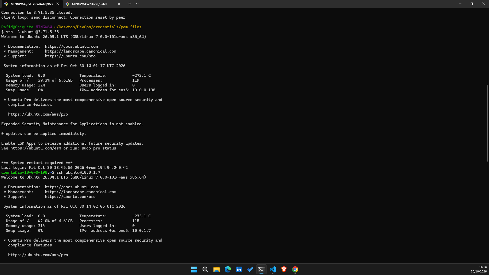
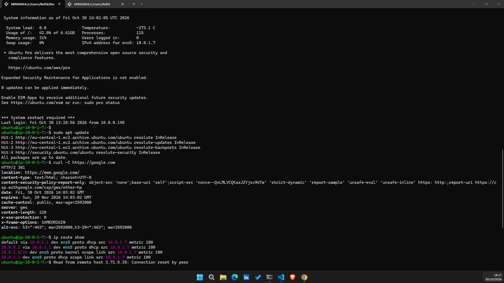

# ShopBondhu AWS Infrastructure & Frontend Deployment

ShopBondhu's launch infrastructure is a secure, custom VPC built on AWS featuring high-isolation networking. The architecture hosts a public-facing Nginx web server for the newly designed static landing page and an isolated backend server in a private subnet configured with outbound-only internet connectivity through an AWS NAT Gateway.

---

## Architecture Diagram
used gpt to generate the dagram, demo frontend and backend

```
                                  ┌────────────────────────────────────────────────────────┐
                                  │ AWS Cloud (VPC: 10.0.0.0/16)                           │
                                  │                                                        │
                                  │        ┌────────────────────────────────────┐          │
                                  │        │ Internet Gateway (shopbondhu-igw)  │          │
                                  │        └─────────────────┬──────────────────┘          │
                                  │                          │                             │
                                  │              Public Subnet (10.0.0.0/24)               │
                                  │  ┌───────────────────────┴────────────────────────┐    │
[Internet Users] ──HTTP (80)─────>│  │ shopbondhu-web (Public EC2)                    │    │
[Engineer Laptop] ──SSH (22)─────>│  │ Running Nginx - Serves Static Landing Page     │    │
                                  │  └────────────────────────────────────────────────┘    │
                                  │  ┌────────────────────────────────────────────────┐    │
                                  │  │ shopbondhu-nat (NAT Gateway + Elastic IP)      │    │
                                  │  └───────────────────────┬────────────────────────┘    │
                                  │                          │ Outbound HTTPS (443)        │
                                  │             Private Subnet (10.0.1.0/24)               │
                                  │  ┌───────────────────────┴────────────────────────┐    │
                                  │  │ shopbondhu-backend (Private EC2)               │    │
                                  │  │ SSH access: shopbondhu-web-sg ONLY             │    │
                                  │  │ Inbound: None | Outbound: via NAT Gateway      │    │
                                  │  └────────────────────────────────────────────────┘    │
                                  └────────────────────────────────────────────────────────┘
 ```
---

### Step-by-Step Setup
1. Custom VPC Creation
A dedicated /16 network was deployed to replace default AWS VPC usage.

2. Subnet Segregation
Two distinct subnets were provisioned: a /24 public tier with dynamic public IP allocation and a /24 private tier for application backends.

3. Internet Gateway Attachment
The gateway provides two-way internet routing for the public subnet.

4. NAT Gateway & Elastic IP Allocation
The NAT Gateway provides outbound network address translation for the private subnet without allowing unsolicited incoming traffic.

5. Routing Architecture
-shopbondhu-public-rt routes 0.0.0.0/0 to shopbondhu-igw.
-shopbondhu-private-rt routes 0.0.0.0/0 to shopbondhu-nat.

6. Security Groups and EC2 Instances
Security groups enforce least-privilege access: the backend server accepts SSH traffic exclusively from the web server security group.

#### Nginx & Frontend Deployment
Nginx was installed on shopbondhu-web, enabled across system reboots, and populated with the ShopBondhu static landing page files.


### Executed on shopbondhu-backend
sudo apt update
curl -I [https://google.com](https://google.com)
Why the Backend Cannot Be Reached from the Internet
RFC 1918 Private Addressing: The backend server only possesses a private IP address (10.0.2.0/24). Private IP ranges are non-routable over the global internet backbone; public internet routers immediately drop packets directed toward them.





Absence of an Internet Gateway in Route Table: The private subnet route table points default outbound traffic to shopbondhu-nat, not an Internet Gateway. A NAT Gateway only processes outgoing requests and translates source IPs; it does not map incoming internet connections.

Security Group Ingress Filtering: Even if traffic reached the VPC boundary, shopbondhu-backend-sg rejects all incoming connection attempts except SSH connections originating from shopbondhu-web-sg.


### Troubleshooting (Task 10)
### Problem A: "The website doesn't open in the browser, but SSH to the web server works fine."
Security Group Missing Inbound HTTP Rule (Port 80):

Cause: check inbund and outbound rule for security groups. While Port 22 is allowed (allowing SSH), Port 80 might not be added or might be restricted to a specific IP rather than 0.0.0.0/0.
In AWS Console, open EC2 > Security Groups > shopbondhu-web-sg. Inspect the Inbound rules tab and verify there is a rule allowing HTTP on port 80 with source 0.0.0.0/0.

#### Nginx Service Not Running or Crashed:

Cause: The Nginx daemon is stopped, failed to start on boot, or crashed due to syntax errors in /etc/nginx/nginx.conf.

How to check: SSH into the web server and run sudo systemctl status nginx. If inactive or failed, run sudo nginx -t to test configuration syntax and inspect error logs using sudo journalctl -u nginx -e.

#### Browser Enforcing HTTPS Automatically:

Cause: Modern browsers often auto-upgrade http://<IP> requests to https://<IP> (port 443). Since SSL/TLS is not configured on the instance, connection attempts to 443 fail with ERR_CONNECTION_REFUSED.

#### How to check: Explicitly type http:// in the browser URL bar (e.g., http://54.x.x.x), test in an Incognito window, or run curl -I http://localhost directly inside the web server terminal.

### Problem B: "On the backend server, sudo apt update hangs and times out."
#### NAT Gateway Deployed in the Private Subnet Instead of the Public Subnet:

Cause: If the NAT Gateway is placed inside shopbondhu-private-subnet, it lacks a direct route to the Internet Gateway. A NAT Gateway must live in a public subnet to forward packets to the internet.

#### How to check: Open VPC Console > NAT Gateways > shopbondhu-nat. Look at the Subnet attribute and verify it matches the ID of shopbondhu-public-subnet.

Missing Route to NAT Gateway in Private Route Table:

Cause: The route table associated with shopbondhu-private-subnet either lacks the 0.0.0.0/0 default route or routes it to a target other than shopbondhu-nat.

#### How to check: Open VPC Console > Route Tables > shopbondhu-private-rt. Verify under the Routes tab that 0.0.0.0/0 points to nat-xxxxxxx. Then check the Subnet associations tab to confirm shopbondhu-private-subnet is explicitly associated.

Missing or Failed Elastic IP on the NAT Gateway:

Cause: A NAT Gateway cannot perform network address translation without a valid, associated public IPv4 Elastic IP. If the EIP was disassociated or the allocation failed, outbound traffic drops.

How to check: Go to VPC > NAT Gateways > shopbondhu-nat and confirm that Elastic IP address shows a valid public IPv4 address, and verify that the NAT Gateway state is Available (not Failed or Pending).

#### Infrastructure Cleanup
To prevent ongoing cloud expenditure after verifying and completing the assignment:

- Deleted shopbondhu-nat.

- Released the associated Elastic IP address.

- Stopped EC2 instances.

#### Why Cleanup Matters for the AWS Bill
NAT Gateway Hourly Pricing: AWS charges a flat fee of $0.045 per hour (~$32.40/month) for running a NAT Gateway, plus data processing fees, regardless of traffic volume. NAT Gateways are not included in the AWS Free Tier.

Elastic IP Inactivity Surcharge: While an Elastic IP attached to a running instance used to have exemptions, AWS now charges $0.005/hour (~$3.60/month) for every public IPv4 address. If a NAT Gateway is deleted but the Elastic IP is left allocated and unattached, AWS bills that unattached IP continuously until manually released.

What I Learned

1. How to build a network infrastructure in cloud.
2. Subnet Classification by Routing: A subnet in AWS is strictly defined as "public" or "private" by its route table associations, not by its name or physical placement. Direct routing to an Internet Gateway creates a public subnet; routing to a NAT Gateway or retaining local-only routes creates a private subnet.
3. Asymmetric Security Group Rules: Security groups are stateful. When opening port 80 or 22 for inbound connections, return outbound traffic is automatically permitted without adding extra egress rules.
4. Cost Optimization in Cloud Architecture: High-availability networking constructs like NAT Gateways and reserved IPv4 addresses carry baseline hourly costs that require proactive teardown during lab learning cycles.
Cost Optimization in Cloud Architecture: High-availability networking constructs like NAT Gateways and reserved IPv4 addresses carry 


                             